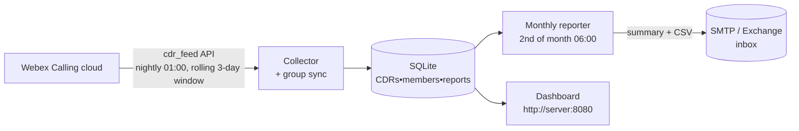
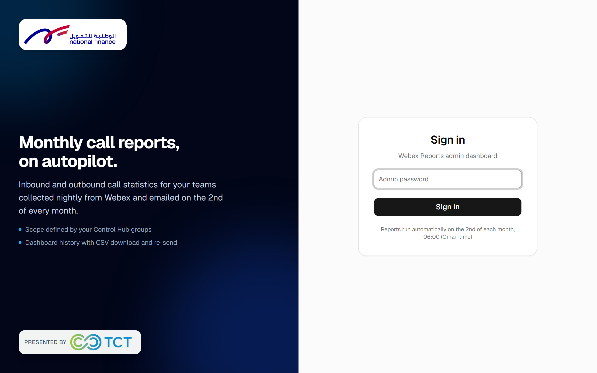
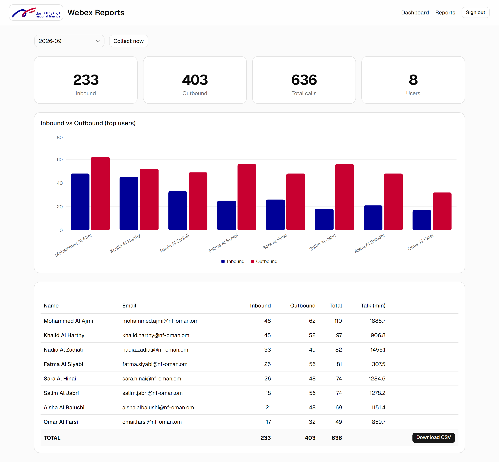
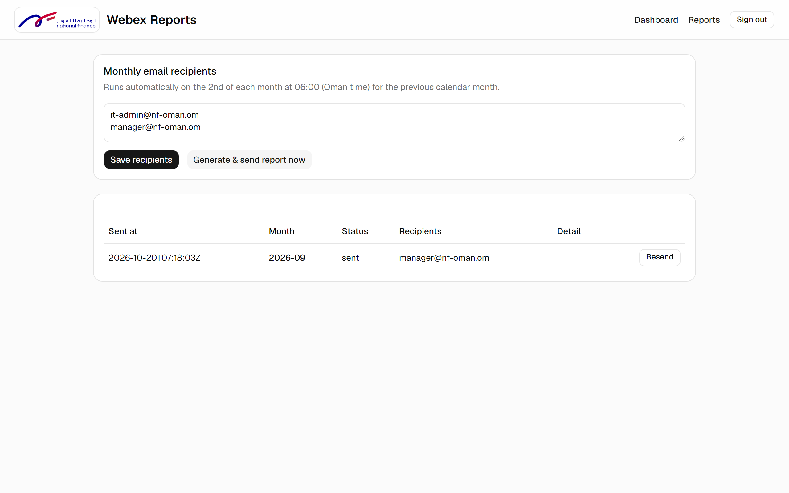

# Webex Call Reporting Tool

[](https://www.python.org/)
[](https://flask.palletsprojects.com/)
[]()
[]()

Automated **monthly call reporting** for [Webex Calling](https://www.cisco.com/c/en/us/products/collaboration-endpoints/webex-calling.html) — per-user **inbound / outbound call counts** and talk time for the users in any Control Hub group, e-mailed automatically on the **2nd of every month**, with a built-in dashboard for browsing history and re-sending reports.

Runs as a **single lightweight service on the customer's own Windows server**. No cloud dependency, no data leaves the network.

---

## Features

| | |
|---|---|
| **Monthly e-mail report** | HTML summary table in the body + CSV attachment, sent at 06:00 on the 2nd of each month |
| **Inbound & outbound** | Counts are split per user; only answered ("handled") calls are counted, with total talk time |
| **Modern dashboard** | [Next.js](https://nextjs.org) + [shadcn/ui](https://ui.shadcn.com): month picker, per-user table, Recharts bar chart, org totals, CSV download — single shared admin login |
| **Group-driven scope** | Users come straight from Control Hub groups — add/remove members in Control Hub and the next report follows automatically, no tool changes |
| **30-day API limit, solved** | A nightly collector keeps call records flowing into a local SQLite store, self-heals missed days, and warns in the report if an older-than-30-days gap could not be collected |
| **Operations built in** | Sent-report history, one-click **resend**, **collect now** / **send now** buttons, configurable recipient list |
| **One process to run** | The Next.js app is statically exported and served by the same Python service — one runtime on the server |

## How it works



- **Collector** — pulls each 12-hour window from the [Detailed Call History / CDR Feed API](https://developer.webex.com/calling/docs/api/v1/reports-detailed-call-history) (`spark-admin:calling_cdr_read`), upserts by record ID, and snapshots group membership daily.
- **Reporter** — aggregates the previous calendar month per user per group-member snapshot (as of month-end), renders HTML + CSV, sends via the customer's own SMTP/Exchange.
- **Dashboard** — Flask app on the same service; single shared admin password.

> **Why nightly?** The CDR Feed API only reaches **30 days** back — a report generated on the 2nd cannot pull a full previous month in one shot. The nightly collector keeps every record young, and re-pulls with a 1-day overlap so late-written records are never lost.

## Quick start

```powershell
py -m venv .venv
.venv\Scripts\pip install -r requirements.txt
copy config.example.json config.json   # fill in your values

# build the dashboard (Next.js static export -> dashboard/out)
cd dashboard
npm install
npm run build
cd ..

.venv\Scripts\python app.py            # dashboard + scheduler on :8080
```

Handy CLI modes:

```powershell
python app.py --collect          # run one collection now
python app.py --report-dry       # print last month's table, no e-mail
python app.py --report 2026-09   # generate + e-mail a specific month
python -m unittest discover -s tests   # Python self-check
```

### Configuration (`config.json`)

| Key | What |
|-----|------|
| `client_id` / `client_secret` | Webex **service app** credentials |
| `scopes` | `spark-admin:calling_cdr_read` + group read |
| `analytics_base_url` | Regional CDR endpoint (`-eu` / `-in` / `-au` variants exist) |
| `report_groups` | Control Hub group names whose members are reported |
| `org_timezone` | `Asia/Muscat` by default |
| `admin_password` | Dashboard login |
| `smtp` | Relay host/port/TLS credentials, sender address |

Secrets (`config.json`, `tokens.json`, `data/`) are gitignored and never leave the server.

## One-time Webex admin setup

1. Create a **service app** in Control Hub (*Organization Settings → Service Apps*) with the CDR + group read scopes.
2. Create the custom role **“Webex Calling Detailed Call History API access”** and authorize the service app with it.
3. Choose your **regional endpoint** (US / EU / India / Australia) to avoid `HTTP 451`.
4. At first run, verify one live CDR against Control Hub’s *Detailed Call History* numbers — field mapping lives in the `cdr_*` helpers of [`jobs.py`](jobs.py), everything else needs no changes.

Full runbook and decision log: [`DESIGN.md`](DESIGN.md).

## Dashboard screenshots







## Project structure

```
app.py          Python service: JSON API, serves the exported SPA, scheduler
jobs.py         Collector • CDR field mapping • aggregation • CSV & e-mail • scheduler
webex.py        Token lifecycle (client-credentials + refresh) & Webex API calls
db.py           SQLite schema & access
dashboard/      Next.js + shadcn/ui front end (statically exported to dashboard/out)
  app/            /login, / (dashboard), /reports pages
  components/ui/  shadcn components
tools/          make_screenshots.py — README screenshots from demo data
tests/          stdlib unittest self-checks
config.json     credentials, groups, SMTP, timezone (**gitignored**)
tokens.json, data/   runtime state (**gitignored**)
```

Screenshots above were generated with `tools\make_screenshots.py` against demo data.

## Operational notes

- Runs via **Task Scheduler** (`pythonw app.py`) or NSSM as a Windows service.
- Logs: `data\service.log`.
- A year of CDRs is a few MB — keep SQLite data indefinitely, or prune `cdrs` table if desired.
- Rate limits respected by design: 1 new API request/minute between windows (~7 min per night).

## License

Internal use — built for a specific customer deployment.
